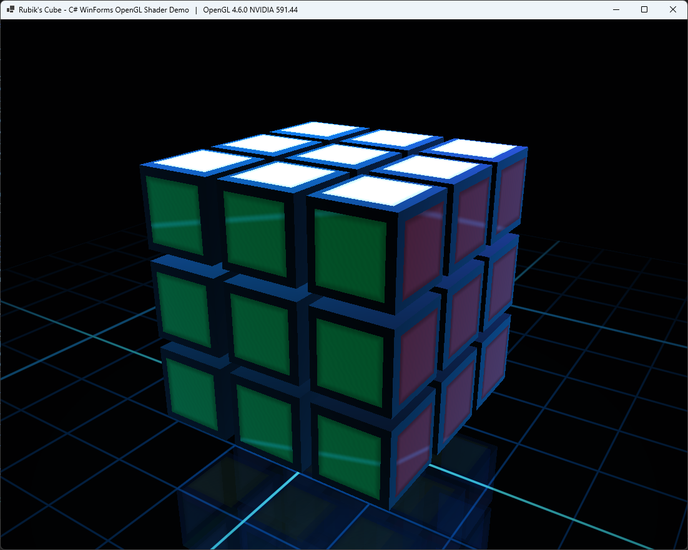

# Rubik’s Cube C# and OpenGL implementation



A small C# graphics demo that renders an interactive Rubik's Cube with modern OpenGL 4 shaders.

The goal of this project is not to use an engine or a ready-made 3D framework, but to keep the rendering pipeline visible: WinForms for the window and input handling, raw OpenGL loaded through P/Invoke, GLSL shaders, custom mesh generation, camera control, animation, and a few visual effects implemented directly in code.

## Features

- Interactive 3D Rubik's Cube
- Mouse-controlled camera rotation
- Mouse wheel zoom
- Keyboard face turns in standard cube notation
- Smooth animated 90-degree turns, queued so that fast typing loses no move
- Scramble and reset support
- Colored cube stickers
- Glossy black plastic body
- OpenGL 4 core profile, 4x MSAA, vsync
- GLSL vertex and fragment shaders
- VBO/VAO-based rendering
- Procedural glowing grid floor
- Simple mirrored floor reflection
- Fresnel-style reflections
- Rim lighting
- Animated scan highlight effect
- Sharp on high-DPI displays (per-monitor DPI aware)
- No third-party libraries

## Tech stack

- C#
- .NET 11 / WinForms
- OpenGL 4
- GLSL
- P/Invoke and unmanaged function pointers
- Windows API / WGL

## Controls

| Input | Action |
|---|---|
| Left mouse drag | Rotate camera |
| Mouse wheel | Zoom in / out |
| `U` | Turn the upper face clockwise |
| `D` | Turn the bottom face clockwise |
| `L` | Turn the left face clockwise |
| `R` | Turn the right face clockwise |
| `F` | Turn the front face clockwise |
| `B` | Turn the back face clockwise |
| `Shift + U/D/L/R/F/B` | Turn the face counterclockwise (U', D', L', ...) |
| `S` | Scramble cube |
| `Ctrl + R` | Reset cube |
| `Home` | Reset camera |
| `Esc` | Close application |

Clockwise means as seen looking at that face, as in standard cube notation, so
move sequences from solving guides can be typed in directly.

## Running the project

Open `RubiksCube.slnx` in Visual Studio, or from the project folder:

```powershell
dotnet run
```

## Requirements

- Windows
- .NET 11 SDK
- GPU and driver with OpenGL 4.0 support

The project uses WGL and `opengl32.dll`, so it is Windows-specific.

## Project layout

```
Program.cs, RubiksForm.cs   window, input, render loop
Puzzle/                     the cube: cubies, moves, scramble, turn animation (no OpenGL)
Rendering/                  OpenGL context (WGL), function loading, shaders, meshes, scene
Shaders/                    GLSL, embedded into the executable
```

## Implementation notes

The application creates an OpenGL 4.0 core profile context from a WinForms window handle through WGL; a throwaway window gives access to `WGL_ARB_create_context` and the multisampled pixel formats. OpenGL functions are loaded through `wglGetProcAddress` and called through unmanaged function pointers. Rendering is done with vertex buffers, vertex array objects, and GLSL shaders, frame after frame whenever the message queue is empty, paced by vsync.

The cube itself is generated procedurally. Each small cubie has a black body and separate colored sticker geometry. Face turns are animated by temporarily applying an additional transform to the cubies that belong to the active layer, then committing their logical positions and sticker orientations after the animation finishes.

The visual style is intentionally more like a small graphics demo than a basic puzzle implementation: the scene includes a dark background, blue rim lighting, glossy highlights, procedural reflections, a glowing floor grid, and a mirrored reflection pass under the cube.

## Why this project exists

I wanted to combine a classic interactive puzzle with a more modern rendering approach while keeping the whole program compact and transparent. No engine, no helper libraries, no hidden rendering framework — just C#, WinForms, OpenGL, GLSL, and the required Windows interop code in a handful of small files.

## Support

If you found this project interesting or useful, you can support my work:

[](https://github.com/sponsors/makarov-mm)
